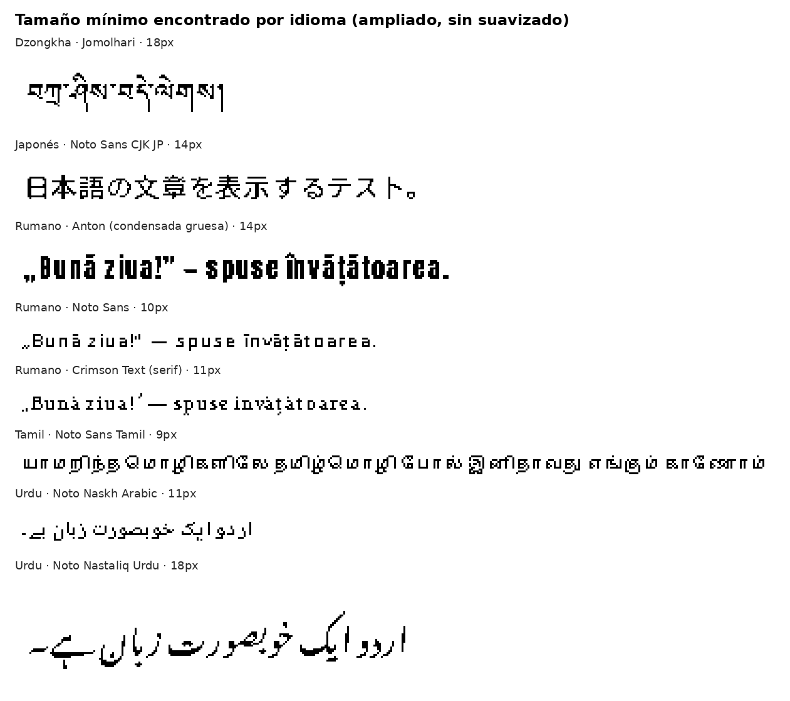

# pixelfont (Diobbi)

Convierte una fuente vectorial (TTF/OTF/TTC) en una **fuente pixel art utilizable**, en cualquier
sistema de escritura, conservando el **motor de la fuente original**: `cmap`, `GSUB`, `GPOS` y
`GDEF` se mantienen. Solo se reemplazan los contornos de los glifos por cuadros alineados a una
rejilla. Todas las posiciones (avances, kerning, anclajes de diacríticos, uniones cursivas del
árabe/urdu, apilados del tibetano) se ajustan a esa misma rejilla. Por eso el shaping complejo
(conjuntos del tamil, Nastaliq, apilados del dzongkha) sigue funcionando sin reglas propias.

Además **busca automáticamente el tamaño mínimo** (px por em) para cada idioma/escritura con una
batería de pruebas.



## Resultados del prototipo (5 idiomas, 8 fuentes)

| Idioma · fuente | Mínimo (px/em) | Altura de línea | Tinta mediana por glifo | OCR pixel / original | Piezas en texto |
|---|---|---|---|---|---|
| Rumano · Noto Sans | **10** | 14 px | 7 px | 0.91 / 0.97 | 126/125 |
| Rumano · Crimson Text (serif) | **11** | 15 px | 7 px | 0.86 / 0.93 | 124/125 |
| Rumano · Anton (condensada gruesa) | **14** | 22 px | 13 px | 0.91 / 0.94 | 120/125 |
| Japonés · Noto Sans CJK JP | **14** | 22 px | 13 px | 1.00 / 1.00 | 75/78 |
| Tamil · Noto Sans Tamil | **9** | 12 px | 6 px | 0.89 / 0.93 | 81/79 |
| Urdu · Noto Naskh Arabic | **11** | 19 px | 7 px | 0.98 / 1.00 | 68/69 |
| Urdu · Noto Nastaliq Urdu | **18** | 46 px | 12 px | 0.76 / 0.83 | 59/61 |
| Dzongkha · Jomolhari | **18** | 29 px | 10 px | 1.00 / 1.00 | 45/45 |

"px/em" es el tamaño nominal de la fuente. Cada diseño ocupa el em de forma distinta: en Jomolhari
las letras son pequeñas dentro del em y en Nastaliq la línea es muy alta por la caída diagonal. Las
fuentes finales están en `salida/*.ttf`, las comparativas en `salida/previews/` y las métricas de
cada tamaño probado en `salida/*.json`.

## Cómo funciona

1. **Preparación** (`prep.py`): instancia las fuentes variables en su estilo por defecto y hace un
   subset por escritura conservando todas las features OpenType necesarias.
2. **Zonas verticales** (`core.detect_zones` / `VWarp`): detecta las alturas clave de la escritura
   (línea base, altura de x, mayúsculas, línea superior del tibetano, etc.) y deforma el eje vertical
   por tramos para que caigan en píxeles enteros. Esto da coherencia entre letras.
3. **Rasterizado supermuestreado** con regla de devanado no nulo, que produce un mapa de cobertura
   por píxel.
4. **Umbral que conserva el estilo**: se elige por fuente para que la tinta total se mantenga. Una
   fuente gruesa sigue gruesa y una fina sigue fina.
5. **Esqueleto**: los píxeles por donde pasa la línea central del trazo se fuerzan para que no
   desaparezcan trazos finos (arcos, rayas). Después se limpian las esquinas en L para lograr
   líneas pixel-perfect.
6. **Reparación topológica** contra la versión en alta resolución: recupera piezas perdidas
   (puntos, diacríticos), reconecta trazos partidos por el camino de mayor cobertura, reabre
   contraformas tapadas, separa piezas fusionadas, endereza bultos y elimina píxeles huérfanos.
7. **Puntos y diacríticos**: las piezas pequeñas que quedaron pegadas dentro de un glifo se
   recolocan con al menos 1 px de separación del cuerpo. Los puntos de un mismo grupo pueden
   tocarse en diagonal, como el triángulo `.#.` / `#.#` de ث/ش/پ, que es la forma habitual en
   pixel art. En las marcas que GPOS coloca aparte (los puntos de Noto Naskh son glifos
   independientes):
   - se igualan los anclajes de cada grupo de marcas, corrigiendo solo diferencias de redondeo
     de 1 px, para que el punto simple, el doble y el triple queden a la misma altura;
   - para cada letra base se busca el desplazamiento que deja **exactamente 1 px de aire** entre
     la letra y sus puntos, ni pegados ni flotando. Cada marca pesa según cuántas letras la ponen
     sobre esa base, así las vocales opcionales o los puntos raros no desplazan a los comunes.
8. **Espaciado**: si en el original una letra deja aire a su derecha, la versión pixel deja al
   menos 1 px. En los lados que se unen, como en el árabe, no se agrega.
9. **Desambiguación**: si dos glifos distintos quedan idénticos, cambia el píxel donde más difieren
   los originales.
10. **Reconstrucción**: `upem = N × 64` (1 px = 64 unidades). Los glifos se escriben como
   rectángulos y GPOS/GDEF, avances y métricas se redondean a la rejilla. Las tablas de hinting se
   eliminan.

### Pruebas por tamaño (`search.py`, `evaluate.py`)

- **Unicidad**: ningún carácter distinto puede quedar con el mismo bitmap. Se ignoran los que ya
  eran iguales en el original, como la coma y la comilla baja.
- **Topología**: piezas y huecos frente a la versión en alta resolución. Es informativa, no
  eliminatoria.
- **OCR real**: se renderiza texto con HarfBuzz + FreeType usando la fuente pixelada, se lee con
  Tesseract y se compara con el OCR de la fuente original. Las líneas que el OCR no lee ni en el
  original se excluyen automáticamente.
- **Piezas en texto**: cuenta las piezas separadas (letras, puntos, acentos) de las líneas de
  prueba renderizadas y las compara con el original. Detecta puntos pegados al cuerpo o letras
  pegadas entre sí, cosas que el OCR suele pasar por alto porque adivina por contexto. Se exige
  ≥ 95 %.
- **Tamaño mínimo** = el primer tamaño que pasa (unicidad, OCR ≥ 90 % del original y piezas) y cuyo
  siguiente también pasa. Esto evita aciertos aislados.

## Uso

```bash
pip install -r requirements.txt          # + tesseract con los idiomas a probar
./get_fonts.sh                           # fuentes de prueba (OFL)
PYTHONPATH=src python -m pixelfont convert fuente.ttf --script latin --size 12 -o salida.ttf
PYTHONPATH=src python -m pixelfont search fuente.ttf --script tamil --ocr tam \
    --text "வணக்கம், நீங்கள் எப்படி இருக்கிறீர்கள்?" --sizes 7-18
python run_tests.py            # los 5 idiomas de prueba
python make_previews.py        # imágenes comparativas
```

Escrituras con perfil: `latin`, `japanese`, `tamil`, `arabic`, `tibetan` (rangos en `prep.SCRIPTS`).
Agregar una escritura nueva consiste en añadir sus rangos Unicode. El resto del motor es común.

## Limitaciones conocidas y próximos pasos

- **Diacríticos pequeños en latín**: a 10–11 px la breve de `ă` y el circunflejo de `î` se aplanan
  a una sola fila y la coma de `ș`/`ț` queda como un punto. Pasan las pruebas, pero se distinguen
  mal. A 12 px ya se ven bien. Falta una regla específica para marcas: altura mínima de 2 px para
  marcas curvas y una forma de coma para la coma inferior. Además, la prueba de unicidad debería
  exigir una distancia de al menos 2 píxeles entre letras acentuadas, no solo que no sean
  idénticas.
- **Árabe/urdu**: los puntos quedan a 1 px de la letra (en el original, 0.7–1.4 px), pero
  todavía hay letras vecinas que se tocan en algunas uniones. Las formas contextuales que solo
  aparecen dentro de palabras, como la «ہ» antes de «ے» en Nastaliq, no reciben el ajuste de
  marcas porque la prueba de uso solo da forma a letras sueltas.
- **Dzongkha y japonés**: con la prueba de piezas más estricta, el mínimo es 18 px y 14 px. En
  dzongkha algunos signos vocálicos tocan letras vecinas a tamaños menores.
- **Topología en CJK**: en kanji densos muchas contraformas pequeñas se fusionan. El OCR sigue
  leyendo bien a 13 px, pero hay margen con simplificación de trazos.
- **Nastaliq**: funciona y conserva la caída diagonal, pero necesita tamaños grandes. Naskh es la
  alternativa práctica para urdu en pixel art.
- **OCR como juez**: es un buen indicador pero ruidoso, y no es lo mismo que un lector humano.
  Conviene combinarlo con revisión humana en las escrituras importantes.
- Solo exporta TTF de contornos. Falta exportar BDF/PCF y atlas para motores de juego (Godot,
  Unity).
- Rendimiento: unos 30 s por tamaño para ~3300 glifos japoneses, en Python puro. Se puede
  paralelizar o mover partes a Rust/Go.

## Licencias

Las fuentes de prueba son OFL 1.1 (ver `licencias/`). Las fuentes generadas son versiones
modificadas y se distribuyen bajo la misma OFL. Si la fuente tiene un *Reserved Font Name*, la
versión pixel debe cambiar de nombre con `--family`. Por eso la de Jomolhari se llama
**Dzong Pixel**.
